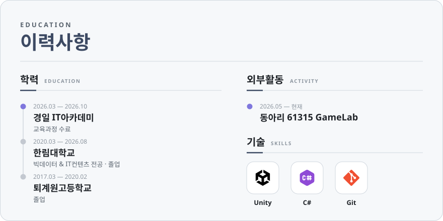
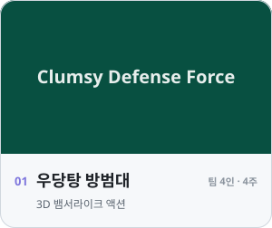
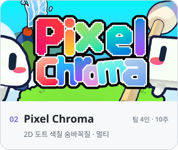
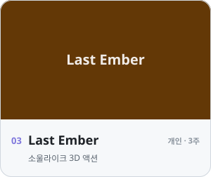
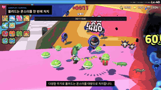
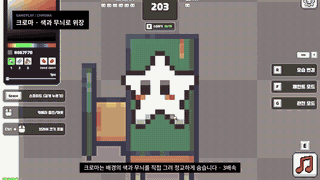
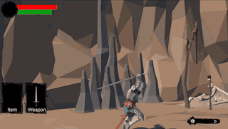

<!-- Header -->

  

  

<!-- 연락처 · 웹사이트 · 포트폴리오 PDF (assets/Portfolio.pdf) -->

  
  
  

 

<!-- 이력사항 패널 (assets/education-*.svg, gen-svg.sh 로 생성) -->

  <picture>
    <source media="(prefers-color-scheme: dark)" srcset="./assets/education-dark.svg" />
    
  </picture>

 

<picture>
  <source media="(prefers-color-scheme: dark)" srcset="./assets/projects-dark.svg" />
  
</picture>

<!-- 프로젝트 카드 (assets/card-*.svg, gen-svg.sh 로 생성)
     정지 이미지: assets/projects/<key>.png 또는 .jpg 를 넣고 gen-svg.sh 재실행 (key: clumsy, pixelchroma, lastember)
     플레이 GIF: assets/projects/<key>.gif (아래 
 토글에서 표시) -->

  <a href="https://github.com/chlwnsdud2025/Clumsy-Defense-Force-Portfolio"><picture><source media="(prefers-color-scheme: dark)" srcset="./assets/card-clumsy-dark.svg" /></picture></a>
  <a href="https://github.com/chlwnsdud2025/Pixel-Chroma-Portfolio"><picture><source media="(prefers-color-scheme: dark)" srcset="./assets/card-pixelchroma-dark.svg" /></picture></a>
  <a href="https://github.com/chlwnsdud2025/Last-Ember-Portfolio"><picture><source media="(prefers-color-scheme: dark)" srcset="./assets/card-lastember-dark.svg" /></picture></a>

  
<b>플레이 영상 보기</b>

   
  

    
    
    
  

 

<picture>
  <source media="(prefers-color-scheme: dark)" srcset="./assets/journey-dark.svg" />
  
</picture>

| 시기 | 프로젝트 | 한 줄 소개 | 영상 |
|:---:|:---|:---|:---:|
| `2025.03` | [Capstone Project](https://github.com/chlwnsdud2025/Capstone-project-Portfolio) | 대학 캡스톤 팀 프로젝트 · Unity 2022.3 | [▶ 보기](https://www.youtube.com/watch?v=UThz7KhKTDc) |
| `2026.04` | [Last Ember](https://github.com/chlwnsdud2025/Last-Ember-Portfolio) | 첫 개인 3D 게임 | [▶ 보기](https://www.youtube.com/watch?v=uUuw1t44cd4) |
| `2026.05` | [우당탕 방범대](https://github.com/chlwnsdud2025/Clumsy-Defense-Force-Portfolio) | 첫 팀 협업 · 3D 뱀서라이크 | [▶ 보기](https://www.youtube.com/watch?v=qPuH5ze9sbI) |
| `2026.06` | [Winter Stove](https://github.com/chlwnsdud2025/Winter-Stove-Portfolio) | VR 도전 · Meta Quest | [▶ 보기](https://www.youtube.com/watch?v=d2nPrdX7Xqs) |
| `2026.07` | [Pixel Chroma](https://github.com/chlwnsdud2025/Pixel-Chroma-Portfolio) | 네트워크 멀티플레이 · Steam | [▶ 보기](https://www.youtube.com/watch?v=vdB4pgSr3JY) |

<!-- 기여 streak 카드 (표시하려면 주석 해제)
 

  

-->

<!-- Footer -->

  

